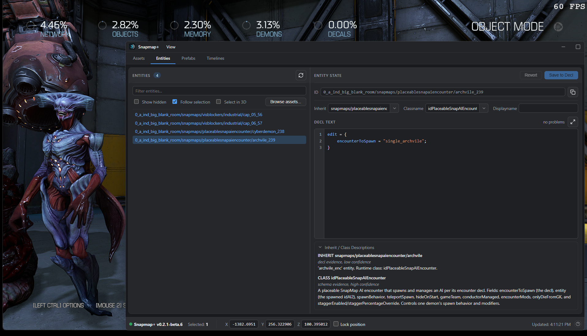
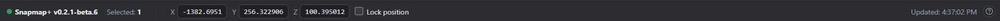
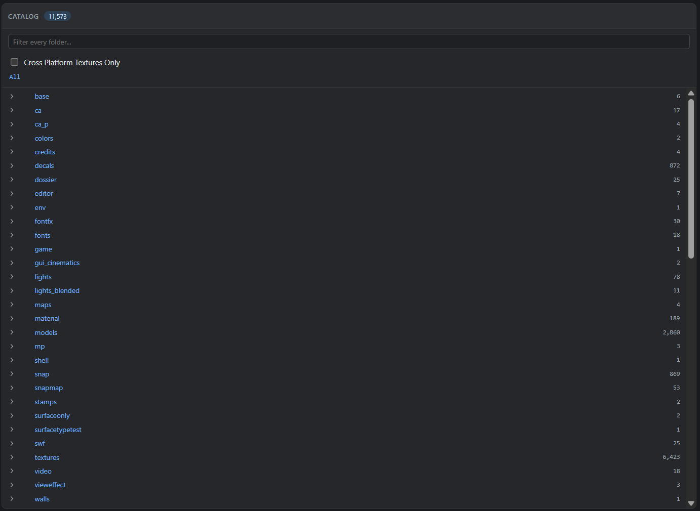
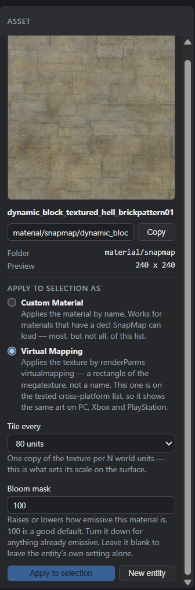
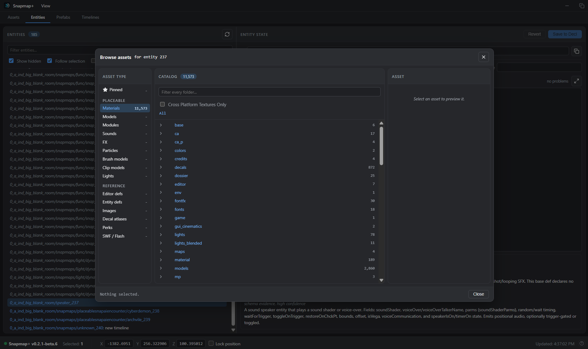
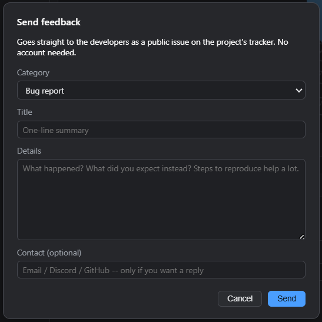

# Guide to Snapmap+

## What is Snapmap+

Snapmap+ is a tool that reads and writes a DOOM (2016) SnapMap file directly, instead of going through
the game's built-in editor UI. That gives you three things the stock editor can't:

- **Properties the Properties menu doesn't expose.** Every entity in DOOM's engine has far more fields
  than SnapMap's UI shows you — Snapmap+ lets you read and write all of them.
- **No editor guardrails.** Name length limits, size limits, and the fixed lists of textures/models/
  effects the Properties menu picks from aren't rules the engine enforces — they're just what the stock
  editor's UI happens to offer. Because Snapmap+ writes the map file directly instead of going through
  that UI, none of those limits apply: you can scale something past the normal max size, or set a texture
  that isn't in SnapMap's own picker at all.
- **Entities SnapMap was never built to place.** The DOOM engine contains far more object types than
  SnapMap's palette exposes. Snapmap+ can place and configure any of them.

Edits that use stock engine behavior and installed assets can travel with the
**map file itself**, including to console players. Features that supply new
runtime resources have additional requirements: **resized Grid Rooms require
Snapmap+ on the player's PC** and cannot be delivered to vanilla or console players.



---

## Resizing Grid Rooms

Highlight a **classic or modern Grid Room** in DOOM's editor and press **X** to
open **Module Properties**. Change **Grid Room Size** X, Y and Z. This works in
Blueprint mode and keeps the Blueprint camera. Left Ctrl opens the action menu;
the size controls are in DOOM itself.

Each room keeps its own dimensions. Doors and frames stay their original size,
and all of the room's built-in lights follow the resized room: they spread with
the walls, the ceiling light stays just under the roof, and the room looks the
same after you save and reload it. Brightness and color do not change. Objects
you placed keep their module-local positions and sizes, so inspect objects near
the walls after shrinking. Connected branches move to retain their doorways;
conflicting connection loops and new overlaps can prevent an edit.

| Grid Room | Original X / Y / Z | Minimum X / Y / Z |
|---|---|---|
| Classic | 2560 / 2560 / 2048 | 416 / 416 / 304 |
| Modern | 5120 / 5120 / 3392 | 864 / 272 / 432 |

Out-of-range values clamp and the panel shows the applied dimensions. Only the
value you changed is adjusted. If a room cannot grow further on that axis, the
panel keeps the size that fits; the Snapmap+ log (`sh_backend.log`) says which
room or connected module reached which limit. A room that already extends past
the limit can always be made smaller. The maximum
follows the current `snapEdit_environmentModuleBounds` cvar, the room's world
position and its connected neighbors. Raising that cvar allows larger rooms
without restarting, up to native collision and navigation coordinate limits.
Snapmap+ does not change the cvar for you. The current process retains up to
64 distinct size/type combinations; restart DOOM if that cache fills.
Keep the world cvar large enough when reopening or playing a map authored with
a raised limit; the room dimensions are saved, but this cvar is not stored in
the map. For example, `snapEdit_environmentModuleBounds 30000` permits a larger
world box, while each room still has to fit at its actual position.

Save and load normally. Collision, navigation and marked blocking-volume
navigation use the resized room. **Players need Snapmap+ to load these maps.**
The resizing feature is included in the existing backend DLL; it needs no
separate file beside the map.

To return a map to vanilla compatibility, restore every Grid Room to its
original dimensions, restore **View Distance** to 8192, and remove any
other mod-only content. Save again.

The faint green surface grid appears when placing or moving objects that use
the game's navigation placement display, such as demons. Its brightness pulses,
so it can become very faint while still enabled. It follows the room's native
display surfaces, rather than covering every wall or appearing for every prop
or logic object. **Snap to Grid** moves the held object to the editing grid;
it does not toggle this display. The custom blocking-volume navigation preview
is a separate overlay.

## Map view distance

Open **Settings > Properties** in DOOM's SnapMap editor and switch to the
**SNAPMAP+ MOD SETTINGS** tab; the setting is **Map View Distance**. Choose
**Apply**, then save your map normally. Cancel
discards unapplied changes. The value is stored inside this map and works with
both OpenGL and Vulkan. Loading another map uses that map's own setting.

| Setting | Default value | Range |
|---|---|---|
| Map View Distance | 8192 (original environment) | 0 (maximum), or 256 to 200000 game units |

**View Distance** decides how far the game draws before the black far-clip
cutoff. It follows one rule:

- **8192 (default):** the map uses each environment's own distance.
  Modules, **Set Environment** and **Player Set Environment** logic nodes and
  campaign environments such as the Lazarus archive (15000) all keep control,
  so your logic can still change the distance during play.
- **0 (maximum):** the map draws to 200000 units, the farthest the game
  allows. It is not infinite. Press left at 0 to jump to 200000; right at
  200000 stays there.
- **Any other value:** the map's View Distance is used everywhere the map is
  drawn, in the editor and in Play. It overrides module environments, Set
  Environment and Player Set Environment nodes, and campaign environments.
  Environment effects such as fog, color and lighting still come from those
  environments; only the distance is replaced.

The editor's own camera limits are separate and are not changed by this
setting. An extended view distance such as 60000 removes the nearby black
cutoff in large Grid Rooms. A room on the **Default** Environment FX draws
to 60000 units in the editor, darkening into fog after about 32000, but only
8192 units in Play. Many other Environment FX stop at 8000, 8192, 10000 or
32768. Use 0 to see the whole room in both the editor and Play. Larger distances can increase rendering cost, so
check the result from several positions in Play mode, especially in large open
rooms. Players need Snapmap+ for a custom value to take effect.

Fog is not a map setting. Use environments and Set Environment nodes for fog.
Maps saved with earlier Snapmap+ versions keep their view distance; their old
map fog values are ignored when the map loads and dropped the next time it is
saved, whether or not you open the settings. Maps
saved with the former enable switch off load with the default distance. A map
saved with 0 when 0 meant "follow the environment" now draws to the maximum;
set 8192 to return it to the environments.

## Map bounds and Blueprint zoom

Snapmap+ adds a third tab to DOOM's **Settings > Properties** panel. Switch
tabs with the bumpers (or Q / E) or click the third diamond at the top of the
panel; the tab is titled **SNAPMAP+ MOD SETTINGS**. Every setting on it is a
Snapmap+ mod. Stepping a number past either end of its range stops at that end.
If the tab cannot be installed on your game build, the same controls appear at
the end of the first tab.

| Setting | Default value | Values |
|---|---|---|
| Unlock Map Bounds | Off (16000, native) | Off or On (32671 game units) |

**Unlock Map Bounds** is an on/off setting. SnapMap normally marks any module
that reaches beyond 16000 units from the map center in X, Y or Z as an invalid
placement. Turning it on widens that box to the largest size the game can
handle, 32671 units, for this map; the editor camera, the Blueprint floor grid
and the Blueprint floor range follow. Choose **Apply**, then save the map; the
setting is stored inside the map and is used whenever the map is edited, played
or loaded directly. A map saved by an earlier Snapmap+ version with a number
between the two keeps that number and shows the setting as On until you change
it.

The highest value is 32671. Collision and AI navigation store world positions
as 16-bit numbers that end at 32767, and navigation reaches up to 96 units
beyond a module, so modules cannot go farther even with Snapmap+.

Only Snapmap+ can open the extra space. Each PC checks module positions with
its own limit when it loads a map, so players without Snapmap+ see the modules
past 16000 as invalid and the game can crash loading the map. Keep the default
for maps you want everyone to play. Turning the setting off removes the
requirement, as long as no module still sits outside the native box.

Snapmap+ also lets the Blueprint camera zoom out until the whole map fits on
screen, on any map: up to 44000 units above the floor instead of DOOM's 16000,
or about 90000 when the map uses **Unlock Map Bounds**. While you are zoomed
out in Blueprint the game draws far enough to keep the floor in view, and the
editor's fog-free space is enlarged so the camera never ends up looking through
a thick blue fog. This is an editor convenience on your PC only and changes
nothing in your maps.

Because the zoom-out limit grows with the map bounds, a fully zoomed-out map
with **Unlock Map Bounds** fills the screen just as a native map does: the
floor grid and the space for modules are about twice as wide in game units,
but they look the same size on screen. Compare the two at the same camera
height to see the difference. Modules can be hovered, grabbed and placed from
any zoom level.

## Installing Snapmap+

### Get the pre-patch DOOM files

Snapmap+ currently targets the DOOM build from **before** the April 2024 patch — the patch changed
enough of the engine's internals that Snapmap+ needs to be rebuilt against it, and that work is ongoing
separately. Until then, you'll need to run DOOM on the previous Steam depot:

1. Press **Windows Key + R**, then enter `steam://nav/console` to open the Steam console.
2. In the Steam console, run:
   ```
   download_depot 379720 379721 2206249600939156631
   ```
3. Once it finishes, find the downloaded files under your Steam folder, typically:
   `C:\Program Files (x86)\Steam\steamapps\content\app_379720\depot_379721`
4. Copy those files into your DOOM install folder (e.g. `C:\Program Files (x86)\Steam\steamapps\common\DOOM`),
   replacing everything when prompted.

Online services (playing and publishing maps) still work on this depot. **Multiplayer/Coop matchmaking
with other players does not** while you're on it.

Running "Verify integrity of game files" in Steam will silently pull you back to the current (patched)
build — if that happens, and you still have the Snapmap+ files installed, remove them first (see below),
verify, then redo the depot-download steps above when you want to go back to editing.

### Install Snapmap+ itself

Download **`snapmap-plus.exe`** from the [Snapmap+ site](./) (or from the project's GitHub Releases page)
and **double-click it**. It finds your DOOM 2016 install automatically by looking through your Steam
libraries, asks you to confirm, and places the overlay. That's the whole install. (In the in-game
console, Snapmap+'s commands and cvars all carry the short `sh_` prefix — `sh_help` lists them.)

A few practical notes:

- **Close DOOM first.** A running game locks the files — the installer detects this and asks you to
  close it rather than failing cryptically.
- If auto-detection can't find DOOM (a non-Steam copy, say), run it from a terminal instead and point
  it at the folder: `snapmap-plus install --doom "C:\path\to\DOOM"`.
- While Snapmap+ is in **beta**, the installer says "No stable release has been published yet" and
  installs the newest beta automatically — nothing extra to do.
- **Already installed?** Double-clicking `snapmap-plus.exe` again shows your installed version, tells you
  when a newer one is available (press Enter to update), and takes any command — `update`, `changelog`,
  `uninstall`, `status` — right there, no terminal needed.
- **Updating later:** run `snapmap-plus update` — it updates both the overlay and `snapmap-plus.exe`
  itself. You never need to re-download anything from the site.
- **Coming from the original SnapHak?** If your DOOM folder still has the original (closed-source)
  SnapHak in it, the installer notices, tells you, and removes its files as part of the install —
  Snapmap+ fully replaces it, so nothing of the old tool needs to stay behind. Your maps, prefabs and
  strings carry straight over: they are copied from the old `%USERPROFILE%\snaphak` folder into
  Snapmap+'s own data folder (`%LOCALAPPDATA%\snapmap-plus`). An old `overrides` folder is left where
  it is (see [Packages](#packages)).
- **Packages from an earlier release?** This release does not use them; see [Packages](#packages).
- **Uninstalling:** `snapmap-plus uninstall` restores your DOOM folder to exactly what it was before.
  Your own Snapmap+ data (`config.json`, prefabs, rawmaps under `%LOCALAPPDATA%\snapmap-plus`) is left
  untouched.
- `snapmap-plus help` in a terminal lists everything else: `status`, `changelog`, `version`.
  `status` and `version` also print your game's identity (`Game: DOOMx64vk.exe: DOOM 2016 build
  13954591 (20240321-104810-ginger-fuchsia, Vulkan, 3d8b4393)`), the same line the app puts on reports.

Snapmap+ supports the current DOOM 2016 on Steam (the April 2024 update). The installer checks
which build you have before downloading anything; if your game is the older 2018 build, it installs
v0.2.1-beta.19, the final Snapmap+ release for that build.

What actually lands in your DOOM folder is small: `XINPUT1_4.dll` in the folder itself (`XINPUT1_3.dll`
on the 2018 build), and
`snapmap-plus-ui.dll` inside a `snapmap-plus\` subfolder. Everything is hash-verified before a single
file is touched, and the installer keeps a record so uninstall reverses exactly what it placed. Your
settings are separate: Snapmap+ creates `%LOCALAPPDATA%\snapmap-plus\config.json` the first time it
starts, rather than shipping one in the installer.

---

## Opening Snapmap+

**Either renderer works — you don't have to pick one.** DOOM 2016 ships two executables built from the
same source, `DOOMx64vk.exe` (Vulkan) and `DOOMx64.exe` (OpenGL), and switches between them by relaunching
itself, so one Steam launch can land you in either. Snapmap+ installs once and loads into whichever
executable is actually running. Nothing to configure.

The renderer lives in the `r_renderAPI` cvar (`0` is OpenGL, `1` is Vulkan), stored in
`%USERPROFILE%\Saved Games\id Software\DOOM\base\DOOMConfig.local`. Changing it is what makes DOOM restart
into the other executable — useful to know if you're chasing a graphics problem, but not something Snapmap+
asks you to touch. OpenGL support is new: it is proven against the shipped OpenGL executable in our tests,
so if you see Snapmap+ behave differently there than under Vulkan, that's worth reporting.

Once installed, open a SnapMap in editor mode. A second window — the Snapmap+ panel — will appear
alongside the DOOM window; you'll need to switch windows (Alt+Tab) to see it, since it doesn't overlay
the game.

**Set DOOM's display mode to Windowed or Borderless while you're editing with Snapmap+ — avoid true
Fullscreen.** Snapmap+'s panel is a separate OS window, and switching away from a truly-fullscreen DOOM
window to look at it can crash the game. Borderless and Windowed don't have that problem.

### The window

Snapmap+'s panel has four tabs — **Assets**, **Entities**, **Prefabs**, and **Timelines** — and a couple
of controls that stay visible no matter which tab you're on:


**View → Light Theme / Dark Theme** switches the panel's whole color scheme. It doesn't follow your
system theme automatically — pick whichever you prefer. Snapmap+ remembers the choice and applies it
before the window first appears on later launches, so a saved dark theme does not flash light while
loading.

`config.json` is safe to leave alone. If you deliberately delete it, Snapmap+ treats that as **Reset
preferences** and recreates the default light setting, Show Hidden off and Entity selection mode off on the
next startup. If the file is damaged, Snapmap+ keeps a timestamped `.corrupt.json` backup, restores defaults,
and tells you once. If it cannot save a window setting, that setting still works for the current session and
the window explains that it was not remembered. Updates, uninstall, and reinstall preserve the file.

The **status bar** along the bottom stays visible on every tab too:



- The green dot plus version string on the left confirms Snapmap+ is connected and tells you which
  build you're running.
- **Selected** shows how many entities are currently selected.
- **X / Y / Z** is your editor camera's live position, and updates continuously while you move around —
  handy for finding coordinates to paste into a property. Check **Lock position** to pin the fields (and
  the camera) in place instead of tracking your movement live; editing a locked field's value moves the
  camera there.
- **Updated** (far right) is a live timestamp of the last change Snapmap+ picked up from the map.
- The **?** icon next to it opens the feedback dialog — see [Reporting Bugs and Requesting
  Features](#reporting-bugs-and-requesting-features).

---

## The Entities Tab


The Entities tab lists every entity placed in your map, by its **reference ID** and, if you've given it
one, its display name. The list keeps itself up to date automatically as you edit — **Refresh** is there
if you ever want to force an immediate re-sync yourself.

- **Filter entities...** narrows the list by typing part of an ID or name.
- **Show hidden** reveals the entities that exist in every map by default (the built-in filters like "any
  player" / "any AI", etc.) — left unchecked, those are hidden so the list stays focused on what you
  actually placed. Snapmap+ remembers the choice.
- **Follow selection** makes the list track whatever you have selected in the SnapMap 3D editor — select
  something in-game, and its row (and the Entity State panel) update to match. Turn it off if you'd
  rather browse the list independently of what's selected in-game.
- **Select in 3D** — the reverse direction: selecting a row (or rows) here also selects the matching
  entity in the SnapMap 3D editor.
- **Browse assets...** opens the [Assets tab](#the-assets-tab) as a modal, scoped to whichever entity is
  currently selected — a shortcut for retexturing or reassigning a model/sound without switching tabs.

Follow Selection and Select in 3D are opposite directions of one mode, so they cannot be enabled together.
Snapmap+ remembers the direction you choose (or that both are off) for the next launch.

- **Deselect** clears whatever's selected in the 3D editor. Occasionally clicking off an object in-game
  doesn't fully deselect it — this button is a reliable way to force it.

Right-clicking one or more selected rows gives you:

- **Copy ID** — copies the reference ID(s) to your clipboard, for pasting into another entity's property
  (e.g. a `targets` list — see [Targets and Logic Signaling](#targets-and-logic-signaling)).
- **Delete** — deletes the entity(ies) exactly as pressing Delete in the 3D editor would, following
  the same rules: objects the editor protects and room doors or caps are not deleted, and Ctrl+Z
  undoes it like any other delete. A message says what was deleted, or why nothing was.
- **Push to stack 0** — adds the entity(ies) to SnapStack's scratch stack 0 (see
  [SnapStack](#snapstack-bulk-editing)).
- **Clear stack 0** — empties stack 0 out, regardless of what's currently selected.

Entities that ship as part of the map's module (rather than ones you placed yourself) also show up in
this list — editing or deleting those isn't permanent; they reset the next time the map reloads. If you
need one gone for good, deleting it directly won't stick — instead, signal it (via a `targets` list, or a
Timeline) to a Remove node/command.

---

## The Entity State Panel

Selecting an entity (in the list, or in-game with Follow Selection on) opens its **Entity State** panel
on the right.


- **ID** — the entity's reference ID, read-only, with a **Copy** button.
- **Inherit** and **Classname** — together, these determine what *kind* of entity this is (see
  [Reclassing an Entity](#reclassing-an-entity)). Each has a dropdown of known values, but you can also
  type a value that isn't listed.
- **Displayname** — the name shown in the SnapMap editor and in the Entities list (not shown to players
  in-game). Editing it here bypasses the editor's character limit, and works even on entities the stock
  editor won't let you rename (filters, for instance).
- **Decl Text** — the entity's full underlying declaration, in the format described in
  [Understanding the Decl Format](#understanding-the-decl-format). This is the same data the Properties
  menu edits a slice of — here you see and can edit all of it. Syntax is colorized as you type, and
  anything the checker flags (an unknown property, a value that doesn't look like the type it expects, an
  enum value outside the known set) shows up as an underline plus a count in the corner — **hover a
  warning to jump to it**. A count of "no problems" doesn't guarantee the map will load — the checker
  catches likely mistakes, it doesn't validate everything the engine does.
- **Focus mode** (the expand icon next to the problem count) — expands the decl editor to fill the
  window, hiding the fields above and below it, for distraction-free editing of a long decl. Save,
  Revert, and the problem count stay right there next to the toggle; press **Esc** or click the icon
  again to leave.
- **Save to Decl** — commits your edits (**Ctrl+S** works as a shortcut while the decl editor has focus).
  Most visual changes won't appear in the 3D editor until you reload the map (copy-pasting the entity, or
  playing the map, will reflect the change immediately even without a reload). **You still need to save
  the map itself from SnapMap's own menu** — Save to Decl only writes the change into the in-memory map
  the editor is holding.
- **Revert** — discards your unsaved edits, reloading the entity's last-saved state.
- **Inherit / Class Descriptions** (collapsible, below the editor) — a short description of what the
  current inherit and classname actually are, when Snapmap+ has one on file.


---

## Understanding the Decl Format

The Decl Text editor uses the same syntax the engine itself uses to store entities, so it's worth
learning the shape of it before you start editing.

A property is written as `propertyName = value;` on its own line — the semicolon matters; a missing one
can produce an error when the map loads. A value that's text (a file path, an entity ID) needs quotes:

```
propertyName = "some/file/path";
```

Many properties are themselves a nested group of sub-properties, wrapped in braces:

```
scale = {
    x = 64;
    y = 64;
    z = 64;
}
```

Nesting can go arbitrarily deep — indentation is optional, but keeping it consistent makes it much
easier to keep track of which brace closes which. If your braces don't balance (a `{` with no matching
`}`, or vice versa), the map will fail to load. Everything for the entity needs to sit inside the
outermost `edit { ... }` block. If you accidentally duplicate a property, only the last copy of it
survives a save.

Some properties are **lists**, using a slightly different shape:

```
renderModels = {
    num = 3;
    item[0] = "models/mapobjects/snapmaps/box_trigger.lwo";
    item[1] = "models/mapobjects/snapmaps/dynamic_block_solid.lwo";
    item[2] = "models/mapobjects/snapmaps/dynamic_block_textured.lwo";
}
```

`item[N]` entries are the list's contents, numbered from 0; `num` is the count. **Keep `num` accurate** —
too low, and Save to Decl will silently drop the out-of-range items; too high, and the game can crash
when you try to play the map. You can freely add or remove items as long as you keep `num` matching.

A couple of things to keep in mind while editing:

- Most visual changes won't show up in the 3D editor until you reload the map, copy-paste the entity,
  or play the map — the underlying data is correct immediately, the editor's live view just doesn't
  refresh itself.
- Custom materials specifically don't preview in the editor at all except on Blocking Volumes — you'll
  need to play the map to see how one actually looks, or temporarily apply it to a Blocking Volume if
  you want an in-editor preview.

---

## Common Properties

A handful of properties come up constantly:

**model** (inside `renderModelInfo`) sets what an entity looks like, referencing a model file path.
Works on any entity.

```
renderModelInfo = {
    model = "zion/characters/monsters/lostsoul/base/lostsoul.md6";
}
```

**scale** is a size multiplier on the model — `2` doubles it, decimals between 0 and 1 shrink it, and a
negative value on one axis flips the model. This goes further than the in-game Size field for Blocking
Volumes: you're not limited to whole numbers or the in-game max size.

**customMaterial** re-textures the entire model with the material specified:

```
renderModelInfo = {
    model = "models/snapmaps/props/hell/monster_skull_01.lwo";
    customMaterial = "textures/snapmaps/hotspots/ind_panels_steel";
}
```

There are many more properties beyond these — most Snapmap+ users end up picking them up from community
references and experimentation, since there isn't a single authoritative list.

---

## AI navigation on Blocking Boxes

Enable **AI Navigation** and **Block Demons** on a Blocking Box to use its exposed,
walkable surfaces for demon navigation. Rotating a box can make one of its sides
the new walking surface. Slopes retain their actual angle, and overlapping boxes
contribute their exposed surfaces.

Default-sized boxes work too, including in maps created before Snapmap+ was
installed, and they keep their navigation preview after you save. You do not need
to resize a box or recreate the map to enable navigation.

For a wall that demons should go around, leave **AI Navigation** off and keep
**Block Demons** on. Ordinary Blocking Boxes already participate as obstacles,
including where they overlap custom navigation. Enable AI Navigation when the
box should also provide a walkable top or slope. Vertical walls and downward
faces do not become walking surfaces; climbing uses approach and landing
connections between valid surfaces.

The green preview shows the smallest demon navigation size. Larger demons need
more standing room and clearance, so a narrow green surface may still be too small
for a hell knight. Climbing also requires an available traversal animation and
clear approach and landing positions; the floor-side positions account for the
whole rotated box, including an overhanging slope.

A map can hold up to 65,536 boxes with **AI Navigation** or **Block Demons** and
8,192 placed modules. Each module copy (a "room" in the messages) bakes up to
2,048 boxes, and up to 2,048 walkable pieces per demon size. Past any of these the
extra boxes are left out and named, and the rest of the map keeps its navigation.

When something does not fit, Snapmap+ leaves out the smallest part it can instead
of refusing the map:

- A box whose size, rotation or room cannot be read, or that two rooms claim, is
  left out on its own. A box in a room whose position cannot be read is left out
  with that room's other boxes only.
- The engine allows at most 256 routes out of one navigation area. When a busy
  floor would pass that, the boxes adding the most routes there give up just
  enough of them.
- The engine loads no navigation tree deeper than 128. A room that would pass it
  keeps three quarters of its floor boxes at a time until it fits.
- Each demon size is baked on its own. If the smallest size cannot be built,
  larger demons still use the boxes, and a size that failed is not baked again
  at Play unless the map changed.
- A room that cannot be built at all keeps its normal navmesh; the other rooms
  are still built.

Boxes that lost routes or were left out this way are drawn amber in the preview.
The completion toast says **Navmesh Built**, **Navmesh Partly Built** with how
many rooms were built and the first room that kept or lost something and why, or
**Navmesh Build Failed** when no room could be built or the map could not be read.
The View menu shows the same summary. Run `sh_navmesh` in the game console for
every room, demon size and box with its reason; `sh_backend.log` has the same
lines. The one route refusal left is a module whose own navigation already fills
an area; the boxes routing into it are marked red. An obstructed or disconnected
route can also stop a demon without removing the navigation mesh. Leave enough
room around wall ends for the intended demon size and keep spawn, approach and
landing points clear.

Build navigation from the editor's Start menu with **Build Navmesh**, beside
**Save**. The game shows **Building Navmesh** while the worker runs, then a
native completion toast, just like ordinary Save. This does not save or name
the map, and it does not require a player start. It also works in Blueprint mode
and with the green preview turned off.

The same operation is available through **View > Update Navmesh** in Snapmap+.
The preview is read when the map opens and when you request an update.
Editing does not read the map. When you add, delete, move or change
the flags of a box with **AI Navigation** or **Block Demons**, the View menu says
**Navmesh is out of date**. Other edits do not change it. The preview hides while
geometry is held. Play always uses the current map: if it changed since the last
update, Play bakes it again. If the View menu says **Could not read this map**,
run `sh_navmesh` for the reason.

Duplicated boxes that share an ID keep their navigation when the map assigns
that ID to one module. An ID assigned to different modules is ambiguous, so the
boxes carrying it are left out; the rest of the map keeps its navigation.
Baking runs in the background, so the previous lines can remain briefly while the new
result arrives. `sh_perf` reports time spent reading the map and building the
preview; `sh_perf reset` clears those counters.

## The Assets Tab

The Assets tab is a searchable browser over **everything DOOM's own shipped files contain** — every
material, model, sound, light, particle and more — with a live preview and one click to put what you
found onto your map. Nothing here is a bundled list Snapmap+ ships: the catalog is built by reading your
own installed game files the first time you open each category, so it's always exactly what your copy of
DOOM has.


The tab is three columns:


**Asset Type** (left) — pick a category. **Placeable** categories are things you can actually put on the
map:

| Category | What it holds |
|---|---|
| **Pinned** | Your own shortlist — star any asset from its row to add it here, regardless of type. Handy for the handful of things you're using right now. |
| Materials | Surfaces/textures. A **Cross Platform Textures Only** filter narrows this down to the ones confirmed to look the same on PC, Xbox, and PlayStation. |
| Models | Props. |
| Modules | Whole pre-built SnapMap rooms — placing one drops a single entity that's both visible and solid. |
| Brush models | The individual wall/floor/detail pieces those rooms are built from. |
| Clip models | Collision shapes, placeable on their own. |
| Sounds | Filed by soundbank rather than by name — most raw sound names are near-identical, so the bank is the only grouping that actually helps. |
| Lights | The light material — the pattern a light shines through. Point vs. spot is chosen separately, from **Create as** (see below). |
| FX, Particles | The remaining placeable effect types. |

**Reference** categories (Editor defs, Entity defs, Images, Decal atlases, Perks, SWF/Flash) are look-up
only — useful for finding a name to type in by hand, but nothing to click-apply, since there's no single
right way to wire something like a Perk or a `.swf` screen into an entity.



**Catalog** (middle) — browse a category's folder tree, or type into **Filter every folder...** to search
across all of it at once. Folders show how many assets are inside; click through, or search, until you
land on the thing you want.



**Asset** (right) — once you pick something, its actual preview shows here: materials and images render
as real pixels (decoded straight from the game's own texture data, not a stand-in icon), and sounds get a
play/stop button so you can listen before committing. Below the preview:

- **Copy** — copies the asset's path, for pasting into a decl by hand.
- **Apply to selection** — writes the asset onto whichever entity you currently have selected, immediately.
  What it writes (and which entities will accept it) depends on the asset type: a material sets
  `customMaterial`, a model sets `renderModelInfo.model`, a sound sets `sound` on a speaker, and so on. If
  the selected entity's class can't use that kind of asset, Snapmap+ tells you why instead of quietly
  doing nothing.
- **New entity** — instead of applying to a selection, stages a fresh one-entity prefab holding the asset,
  picked up and ready to place exactly like Ctrl+V.
- A material specifically offers **Custom Material** (applies it by name) or **Virtual Mapping** (applies
  it as a rectangle of the shared megatexture instead of by name — the way to reach materials that have no
  name of their own) — plus a **Tile every** size and a **Bloom mask** strength.

**Reaching it from an entity you already have selected:** click **Browse assets...** on the [Entities
tab](#the-entities-tab) to open the same browser shown above as a modal, scoped to that entity — apply an
asset straight to it without leaving the Entity State panel.



---

## Reclassing an Entity

Every entity has an **inherit** and a **classname**. Changing either — or both — turns one type of
entity into another.

**classname** determines the entity's actual type in the engine, and what properties are meaningful for
it. **inherit** determines what default values it starts from, and how the entity behaves while you're
still in the editor. The two have to agree with each other — a classname/inherit mismatch is a reliable
way to crash the map.

**Props are the safest thing to reclass.** They have no placement or rotation restrictions, and they
don't carry hidden properties left over from a different entity type that could conflict with the type
you're converting to.

```
Inherit:   snapmaps/volume/blocking
Classname: idVolume_Blocking
```

A worked example — turning a prop into a Mover (a scriptable-movement entity):

1. Change **Classname** to `idMover`
2. Change **Inherit** to `snapmaps/func/snap_lift`
3. Save to Decl
4. Save the map and exit the editor
5. Re-open the map

Change both fields, then save — changing one and saving before the other is exactly the mismatch that
crashes the map.

---

## The Custom Palette Tab

Some entities exist in the DOOM engine but have no resource file made for SnapMap, so there's nothing to
put in **inherit** for them. Snapmap+ handles this with a generic `snapmaps/unknown` inherit that's
compatible with any classname — no mismatch risk, regardless of what type you're setting up.

Rather than making you build one of these by hand every time, Snapmap+ seeds ready-to-place starting
points — **Unknown**, **Timeline**, and **Lift** — directly into DOOM's own Create menu, under a
**"*Custom"** tab. They are built into Snapmap+ and served from memory; nothing is written to your data
folder.


Drop either one in like any other object, then reclass it from there (see
[Reclassing an Entity](#reclassing-an-entity)) if you want a specific engine type rather than a bare
Unknown. If no model is set, an Unknown entity shows as a wireframe box in the editor — that box never
appears in the actual game, it's an editor-only placeholder.

Steps to reclass one manually, if you're not starting from the *Custom tab:

1. Change **Classname** to the type you want.
2. Change **Inherit** to `snapmaps/unknown`.
3. Save to Decl — only after **both** fields are changed, not one at a time, or the map will likely
   crash from the momentary mismatch.
4. Save the map, exit, and re-open it (or copy-paste the entity and delete the original).

---

## Targets and Logic Signaling

Every entity in the engine can have a `targets` list — this is a lower-level version of the signal
system SnapMap's own logic nodes are built on top of. Adding an entity to another's `targets` list has
the same effect as drawing a SnapMap logic line between them:

```
targets = {
    item[0] = "1_ind_totally_blank_room_4x/snapmaps/unknown_3923";
    num = 1;
}
```

What happens when the signal arrives depends on what's receiving it. Signaling an FX or a light directly
toggles it on/off. Entities with a classname starting `idTarget_` do something more specific when
signaled — `idTarget_Damage` deals custom damage to everything in its own `targets` list,
`idTarget_DummyFire` fires a projectile at them, and so on; think of these as the engine-level version of
SnapMap logic Inputs like "Spawn Object" or "Start Timer".

Because `targets` and SnapMap's own logic system both drive the same underlying signal, you can mix
them: add a `targets` list to a SnapMap logic **output** (On Spawned, On Entered, On Used...) or a
**filter** (Player Filter, Boolean Filter...), and firing that output/filter also signals whatever's in
the list — letting your normal SnapMap logic reach entities that aren't SnapMap logic nodes at all.

**`sh_target_any`** (a DOOM console command — press **~** to open the console) is a second way to wire
this up, without touching decl text at all.
While it's toggled on, entities that would normally need a `targets` list become valid endpoints for the
native wire tool — so you can drag a wire from a logic node straight to one, the same way you'd wire two
ordinary SnapMap logic nodes together, instead of typing an ID into a `targets` list by hand. Run
`sh_target_any` again to turn it back off and return to normal SnapMap logic wiring.


---

A lot more becomes possible once you're editing raw decls directly -- turning entities into Movers
(scripted movement/rotation), universal entity spawners, Particle Emitters, custom-animated models, and
binding entities together so they move as one. That's engine-level territory rather than a Snapmap+ UI
feature as such, so it's covered separately rather than here.

---

## The Prefabs Tab


The Prefabs tab saves a group of entities so you can reuse it later, or share it with someone else
running Snapmap+.

**Creating one:** select the entities in the SnapMap editor, then click **Create from selection**. Give
it a name, and it's added to the list. **Your cursor must be hovering one of the selected objects when
you do this** — whichever object that is becomes the one centered on your cursor when you later paste
the prefab back in. SnapMap anchors the prefab on the line through the **centre of your view**, not on
the cursor. If that line misses the hovered object, Snapmap+ anchors the prefab on the hovered object
itself instead and says **grab point corrected** when it saves. Without this the saved positions could
come out scrambled. When you paste, the prefab appears in front of the camera, turned by however much
your heading has changed since you created it.

**Using one:** select a prefab in the list to see its details on the right — its name, description, and
tags, plus an **interactive 3D preview** of what you're about to place: drag to orbit, scroll to zoom,
double-click to frame it. The preview colors entities by what they do — solid, blocking, AI Navigation,
interactable, logic/I/O, triggers — so you can tell what a prefab actually contains before you drop it in.
It shows the prefab level and upright, the way it pastes, even when it was created while hovering a tilted
ramp. Blocking Boxes ticked for **AI Navigation** are tinted green, and their number appears beside the
entity count. Click **Load / Place** to stage the prefab for placement with SnapMap's built-in paste
function, then switch to the editor and press **Ctrl+V** to actually drop it into the map. When the
placed prefab brings in AI Navigation boxes, Snapmap+ updates the navmesh by itself as soon as you drop
it, just as **View > Update Navmesh** would.

**Organizing:** **New Folder** creates a folder you can drag prefabs into; **Filter prefabs...** narrows
the list by name. Selecting a prefab and clicking **Delete** removes it permanently.

Prefabs are stored as individual files under `%LOCALAPPDATA%\snapmap-plus\prefabs\` — sharing one is just
sending someone that file; they drop it into their own `prefabs` folder (or the matching subfolder, to
land it in the same folder on their end) and it shows up in their list. You can drop a file into that
folder from Windows while Snapmap+ is already running — no restart needed, it picks the new prefab up
right away.

---

## The Timelines Tab

A **Timeline** is a single entity that can run multiple scripted actions, on multiple other entities, at
the same or staggered times. Timelines are painful to set up by hand in the raw decl text, so Snapmap+
gives them a dedicated editor.


**Getting a Timeline into your map:** place one from the **\*Custom** palette tab (see
[The Custom Palette Tab](#the-custom-palette-tab)) — this is the reliable way to do it, since it comes
with a valid module location already baked in. It's worth giving each Timeline a unique **Displayname**
so you can tell them apart in the list.

Once it's placed, it shows up here automatically — find it in the list and double-click to open it in the
editor on the right.

A Timeline is organized into **entity events** and **eventcalls**. For every entity you want to script,
you add one entity-event tab; under that tab, you add one eventcall per script you want to run on that
entity.

- The **+** tab adds a new entity-event tab, labeled **Item N** (matching the underlying decl's own
  `item[N]` numbering).
- **Runs on** picks which entity that tab's eventcalls apply to — type an ID, pick from the dropdown, or
  select the entity in the SnapMap editor and click **Use current selection** (exactly one entity must be
  selected for that to work).
- **Add Eventcall** appends a new, blank script call under the current tab.
- Each eventcall has a **Time** (milliseconds of delay between the Timeline firing and this eventcall
  running — can be left blank) and an event/script name — type to search, or pick from the dropdown. Once
  a script is picked, its specific parameters appear below it as proper typed fields (a checkbox for a
  boolean, a coordinate row for a vector, a constrained dropdown for a decl/enum reference) — unlike Time,
  every one of these needs a value, or you'll hit errors.
- **What does this event do?** (collapsible, under a configured eventcall) gives a short explanation of
  the selected script, when one's on file.
- **Save Timeline** commits your edits to the Timeline entity. As with any other entity, **you still need
  to save the map itself** from SnapMap's own menu afterward. **Revert** discards local edits and re-reads
  the Timeline as it currently exists on the map.

A Timeline isn't a native SnapMap logic node, so signaling it only works through
[Targets](#targets-and-logic-signaling) — either by adding its ID to another entity's `targets` list
directly, or by turning on `sh_target_any` and wiring it up with the native wire tool.

---

## Rawmaps

A **rawmap** is a human-readable JSON copy of a map. Use one to share a map
without publishing it, keep backups, or edit its contents in a text editor.
The default file is `%LOCALAPPDATA%\snapmap-plus\rawmap.json`.

All rawmap actions are in the **File** menu:

| Menu option | What it does |
|---|---|
| **Load Rawmap...** | Pick a rawmap file. Snapmap+ asks if you want to open it now. **OK** opens it as a new map and discards unsaved edits in the editor. **Cancel** keeps the file waiting, so you can save your work first. |
| **Save Rawmap** | Write the map you are editing to the **Save Path**, including unsaved edits. |
| **Save Rawmap As...** | Pick a file and write the map you are editing to it. Later **Save Rawmap** clicks go to the same file. |
| **Open *file* as New Map** | Open the rawmap that is waiting. It shows the file name, and it is grey when no file is waiting. Use it after you cancel **Load Rawmap...**, or to open a rawmap again after you change it in a text editor. |
| **Keep This Save Path** | Ticked after **Save Rawmap As...**. Untick it to send saves back to the default file. Opening another map also sends saves back to the default file. |
| **Use Rawmaps for Every Save/Load** | Off by default. On, every map you open is replaced by the **Load Path** file, and every DOOM Save also writes the **Save Path** file. The console commands `sh_rawmaps_on` and `sh_rawmaps_off` do the same. |

Under these options, **Load Path** and **Save Path** show the files Snapmap+
uses. Hover over one to see the full path.

A rawmap you open is a new map. DOOM's own Save asks for a new name, so it
does not replace the saved map it opened over. If Snapmap+ cannot give that
protection, it refuses to load rawmaps. Opening a rawmap in place needs at least
one local map saved through DOOM. You can also open a map from DOOM's list while
a rawmap is waiting.

A save is refused when no map is open in the editor. A save is cancelled if you
leave the map before it runs.

Rawmaps are saved as compact JSON on one line. To save them with line breaks and
indents, type `sh_pretty_on 1` in the console before you save. Type
`sh_pretty_on 0` to go back to compact JSON.

Run `sh_rawmaps help` for the console commands. `sh_rawmaps list [folder]`
lists rawmap files, `sh_rawmaps load <path>` stages a file, `sh_rawmaps load`
opens it, and `sh_rawmaps save [path]` exports the live map. Console loads
discard unsaved edits without a confirmation prompt. The advanced command
`sh_rawmaps overwrite on` allows DOOM's Save to replace the borrowed saved map;
that choice lasts only until DOOM closes. Keep it off to preserve that map.

---

## SnapStack (Bulk Editing)

**SnapStack** lets you edit many entities at once from the **DOOM console** (press **~** to open it),
instead of one at a time through the Entity State panel. Every command starts with `sh`.

### The stack/group model

Most SnapStack commands work against a **stack** — a scratch list of entities, numbered (stack 0 is the
default) — or a **group**, a *named* list that (unlike a stack) doesn't get cleared out after you use it.
Groups are what you want for running several edits against the same set of entities without reselecting
them each time.

- `sh psel [stack]` — takes your current in-game selection and pushes it onto a stack (default stack 0).
  De-selects everything in-game once it's stored, and reports how many entities landed in which stack.
  Right-clicking a row in the Entities tab and choosing **Push to stack 0** does the same thing for that
  one entity.
- `sh phov [stack]` — pushes whatever entity you're currently hovering (not necessarily selected) onto a
  stack. Pushing the same one twice doesn't duplicate it.
- `sh pr [stack] [lo] [hi]` — pushes every valid id in the inclusive range `lo..hi` onto a stack, without
  needing to select any of them first.
- `sh pg [name] [stack]` — pushes a named group's ids onto a stack (`sh pg [name]` alone targets stack 0)
  — the reverse direction of `pop2g` below.
- `sh pop2g [stack] [name]` — moves a stack's contents into a named group (replacing that group's
  previous contents, if any).
- `sh popsel [stack or group]` — re-selects, in-game, everything stored in a stack or group. Useful both
  for finding something you can only see in the Entities list, and for pulling a group's contents back
  into a stack you can run other commands against.
- `sh cstk [stack]` — empties a stack out. (Right-clicking in the Entities tab and choosing **Clear stack
  0** does the same thing for stack 0 specifically.)

### Narrowing a stack

Once a stack has entities in it, you can filter it down before running an edit — useful when a selection
(or a range/group) contains more than what you actually want to change:

- `sh filtinh [stack] [inherit]` — keeps only the stacked entities whose **inherit** matches.
- `sh filtcls [stack] [classname]` — keeps only the stacked entities whose **classname** matches.

### Bulk-edit commands

All of these take `[stack or group]` first, then more arguments, and (when a stack is used) clear that
stack once they run:

| Command | What it sets |
|---|---|
| `sh bsi [stack/group] [property path] [value]` | An integer property |
| `sh bsf [stack/group] [property path] [value]` | A float/decimal property |
| `sh bsb [stack/group] [property path] [value]` | A boolean property (`true`/`false`) |
| `sh bss [stack/group] [property path] "[value]"` | A string property (quote the value) |
| `sh bsin [stack/group] [inherit path]` | The **inherit** of every entity in the stack/group |
| `sh bscls [stack/group] [classname]` | The **classname** of every entity in the stack/group |
| `sh bsincls [stack/group] [inherit] [classname]` | Both inherit and classname together, safely (no momentary mismatch) |
| `sh bse [stack] [property path]` | Sets a string/reference property on every OTHER entity in the stack to the ID of the LAST entity selected before `sh psel` |
| `sh accl [stack]` | Pops the LAST entity selected before `sh psel` as a receiver, and reference-assigns every OTHER entity in the stack onto it |
| `sh acctargets [stack]` | Appends every OTHER entity in the stack to the `targets` list of the LAST entity selected before `sh psel` |

`[property path]` uses dots for nested properties — `clipModelInfo.size.x`, `renderModelInfo.color.r`,
and so on, the sub-property you want to change written last. Get `inherit`/`classname` wrong together
(with `bsin`/`bscls` alone rather than `bsincls`) and you risk the same mismatch crash as reclassing a
single entity by hand — see [Reclassing an Entity](#reclassing-an-entity).

`bse`, `accl`, and `acctargets` all need to know which entity was selected *last* — since groups don't
track that, those three only work against a stack.

One more, a bit different from the rest: **`sh mkcmd [stack]`** synthesizes a reusable command-entity
macro out of everything currently in a stack, rather than editing a property on each entity directly.

### A few worked examples

**Retexture a group of objects at once:**
```
(select the objects to receive the property)
sh psel
sh bss 0 renderModelInfo.customMaterial "material/snapmap/dynamic_block_solid"
```

**Bind several objects to a mover, all at once, with rotation:**
```
(select the objects to bind, not the mover)
sh psel
sh pop2g 0 binds
sh bsb binds bindInfo.bindOriented true
sh popsel binds
(select the mover)
sh psel
sh bse 0 bindInfo.bindParent
```

**Wire one entity to signal several others via `targets`, quickly:**
```
(select the entities that should be signaled)
(then also select the entity that will do the signaling — last)
sh psel
sh acctargets 1
```

### New in Snapmap+

A few extra commands beyond the original SnapStack set, for inspecting stacks/groups directly instead of
guessing what's in them:

| Command | What it does |
|---|---|
| `sh chkstk [N]` | Inspect stack `N` (ids + id-strings); omit `N` to summarize every non-empty stack. |
| `sh chkgrp [name]` | Inspect a group's ids; omit `name` to list every group and its count. |
| `sh clrgrp <name>` or `sh clrgrp *` | Delete a named group entirely (`*` deletes all of them). |
| `sh snapstack_diag` | Diagnostic: reports which SnapStack implementation is currently handling commands. |

---

## Packages

The package system is being rebuilt for the April 2024 DOOM update (Steam build 13954591). This
release reads, installs and carries no packages: nothing is loaded from
`%LOCALAPPDATA%\snapmap-plus\overrides\`, no `package-cache` or `package-staging` folder is created,
and a map saved or published with packages by an earlier release loads as a plain map without them.
Folders that earlier releases left are not touched; you can keep or delete them.

---

## Advanced: Every Console Command

Everything above covers Snapmap+ through its window. Snapmap+ also adds a set of commands straight to
DOOM's own console (press **~** to open it) — some are shortcuts for things the window already does,
others are console-only tools with no window equivalent. Run **`sh_help`** at any time to print the
full, current list with descriptions directly from the running build; the tables below are the same
list, organized by what each command is for. (Not repeated here: `sh` and its bulk-edit subcommands,
`sh_target_any`, and `sh_rawmaps_on` / `sh_rawmaps_off` — those are covered in their own
sections above.)

### Inspecting entities and resources

| Command | What it does |
|---|---|
| `sh_spawn <entitydef> <name>` | Spawn an entity definition at your position and teleport to it. |
| `sh_dumpdef <entity name>` | Print — and copy to your clipboard — an existing entity's resolved entity definition. |
| `sh_spawninfo` | Generate `spawnOrientation` / `spawnPosition` values from your current position in the map. |
| `sh_entlist` | List every editor entity type the engine knows about. |
| `sh_listres <resource class> [filter]` | List every resource of a given class (e.g. `idMaterial`), optionally filtered by name. |
| `sh_type <type or enum> [-v]` | Print the fields of an idTech class, or the values of an enum. Add `-v` to also see each field's byte offset and size. |
| `sh_validclasses <inherit>` | List the engine-valid classnames for a given inherit — the same list that fills the Classname dropdown in the [Entity State Panel](#the-entity-state-panel). |
| `sh_dumpmap <name>` | Dump the currently generated `.map` (including SnapMap's own auto-generated version) to a file, for debugging. Works in the SnapMap menu as well as in the editor. The name is **game-relative**, not a Windows path: a bare name lands in `<game dir>\base\mapdumps\<name>.map`, and the `.map` extension is always forced. Dumping the same name twice never overwrites — repeats become `<name>_2.map`, `<name>_3.map`, and so on. Pass a name containing a `/` (e.g. `arena/pass1`) to choose your own subfolder under `base\`; it is created for you. The command prints the full path it wrote. |

### Rawmaps

| Command | What it does |
|---|---|
| `sh_rawmaps` | Show the rawmap state, the Load Path and the Save Path. `sh_rawmaps help` lists every verb: `list`, `on`/`off`, `load`, `save`, `savepath`, `default` and `overwrite`. See [Rawmaps](#rawmaps). |

### Compiling assets

| Command | What it does |
|---|---|
| `sh_genbmodel <input> <output>` | Generate a bmodel from a `.obj`, `.ase`, or `.lwo` file. |
| `sh_genmd6model <input> <output>` | Compile a `.md6model` into a `bmd6model`. |

### Player cheats

Five toggles for your own player, mainly useful while testing a map solo:

| Command | What it does |
|---|---|
| `noClip` | No-collision flight. |
| `infiniteHealth` | You can't lose health. |
| `noPlayerDeath` | You can't die. |
| `noPlayerKill` | You can't be killed outright. |
| `noTarget` | Enemies ignore you. |

### Cvars

Settings you read or change with `<name>` or `<name> <value>` in the console:

| Cvar | Default | What it does |
|---|---|---|
| `sh_pretty_on` | `0` | Type `sh_pretty_on 1` to turn on, `sh_pretty_on 0` to turn off. On, it pretty-prints every rawmap Snapmap+ saves: **Save Rawmap**, **Save Rawmap As...**, `sh_rawmaps save`, and DOOM's own Save while **Use Rawmaps for Every Save/Load** is on. At `0`, rawmaps are compact JSON. |
| `sh_copy_reslist_to_clipboard` | `0` | Copy `sh_listres` output to the clipboard automatically. |

### Developer and diagnostic tools

The rest exist mainly for Snapmap+'s own developers to debug the engine hooks — you're unlikely to need
them, but they're listed here for completeness since `sh_help` shows them too:

| Command | What it does |
|---|---|
| `sh_navmesh` | Show the baked AI navigation the current map uses: which modules and nav classes, or why a bake was refused. See [AI navigation on Blocking Boxes](#ai-navigation-on-blocking-boxes). |
| `sh_navmesh marks [count]` | Mark navigation boxes red in the preview, the same way a refused bake marks them. It marks up to `count` boxes in each module (default `4`, maximum `24`). `sh_navmesh marks 0` clears the marks. |
| `sh_perf` | Show where Snapmap+ spends frame time, such as reading the map and building navigation previews. `sh_perf reset` sets the counters to zero. `sh_perf read` times two ways to read the open map: the whole map at once, and each entity one at a time. It also estimates the cost to read only the navigation boxes. Run it with a map open in the editor. |
| `sh_alginfo` | Report the status of Snapmap+'s optional math-acceleration layer. |
| `sh_debugrender` | Renderer debug toggle; `sh_debugrender dumprenderinfo` prints how many rendermodels are active, then names them. |
| `cs_dontuse` | Toggle higher-precision engine-math overrides — a performance tradeoff, off by default; the name is the warning. |
| `sh_superscriptop` | Dump SuperScript / eventDef data. |
| `cs_dumpeventdefs` | Dump every eventDef to a file. |
| `cs_fieldinfo` | Print field info for a type. |
| `cs_start_render_logging` | Set up the render-logging hook. |
| `sh_disable_devmode` / `sh_reenable_devmode` | Turn DOOM's developer features off, or back on, without losing your Bethesda.net connection. |
| `sh_dialogtest [id] [buttons] [text]` | Raise DOOM's own modal dialog carrying the given text. |
| `sh_dialogpoll` | Read the answer to the dialog `sh_dialogtest` raised. |
| `sh_dialogdump` | Print the engine's dialog queue: id, button set, and flag bytes. |

---

## Reporting Bugs and Requesting Features

Snapmap+ has a built-in way to send feedback straight to the developers — no GitHub account, no email,
no leaving the game. Click the small **?** button in the bottom-right corner of the status bar to open
the **Send feedback** dialog.



Fill in:

- **Category** — Bug report, Feature request, Incorrect description / info (something in this guide or
  the app's own text is wrong), or Other.
- **Title** — a one-line summary.
- **Details** — what happened, what you expected instead, and steps to reproduce if it's a bug. The more
  specific, the more useful.
- **Contact** *(optional)* — an email, Discord handle, or GitHub username, only if you want a reply.

Each report also carries the Snapmap+ version, the renderer you are running and your game's identity,
such as `DOOM 2016 build 13954591 (20240321-104810-ginger-fuchsia, Vulkan, 3d8b4393)`: the DOOM build, the game's own build name, the renderer
and the start of the executable's fingerprint. That is how the developers tell which DOOM a report came
from; nothing else about your PC is sent.

Click **Send** and it's filed as a public issue on the project's tracker under the category you picked.
If someone's already reported the same thing, Snapmap+ recognizes the duplicate and adds your report as
a note on the existing issue instead of creating a new one.

The same reporting pipeline also backs Snapmap+'s **crash report** dialog: if the game hits a serious
fault, a crash dialog opens (right away if Snapmap+ recovered in place, or on your next launch otherwise)
with the error, an optional description of what you were doing, and a checkbox to attach recent log text
(anonymized — your Windows account and machine name are stripped before anything is sent). Sending it
files a `crash`-labeled issue the same way, and repeat crashes at the same spot get grouped onto one
issue rather than filing duplicates.

Nothing is sent unless you click Send — Snapmap+ makes no other network requests on its own.

**Reporting without the app.** If you open an issue on GitHub yourself, say which DOOM build you are
on: run `snapmap-plus status` in a terminal and paste its `Game:` line (for example
`DOOM 2016 build 13954591 (20240321-104810-ginger-fuchsia, Vulkan, 3d8b4393)`). If Snapmap+ will not install, say whether your game is
the April 2024 update or the 2018 build.
